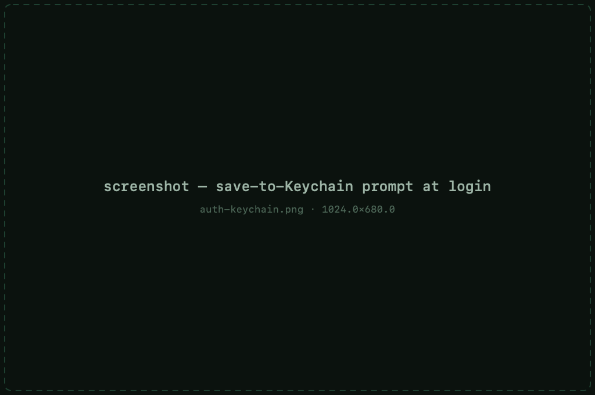

# Authentication

The **SSH** pane of a session's settings controls how you prove who you are.
MaciTTY supports every common way in:

| Method | What to set |
|---|---|
| Password | Type it at the login prompt — you can save it to the Keychain on the spot |
| Keyboard-interactive | The server drives a prompt flow (used by OTP/bastion setups) — answered interactively |
| Public key | Point **Private key file** at your key (`~/.ssh/id_ed25519`, `id_rsa`, …) |
| ssh-agent | Keys loaded in your agent are offered automatically |
| Certificates | SSH certificate auth — select the cert alongside the key |
| Kerberos / GSSAPI | Enterprise SSO — uses your existing Kerberos ticket |

## Saving passwords to the Keychain

When a server asks for a password, the prompt offers to remember it. Accept,
and the password is stored in your **login Keychain** — every connection
after that authenticates without asking. Passwords live in the Keychain, not
in session files, and are never included in [iCloud sync](privacy.md#icloud-sync).

## Public keys

Set **Private key file** on the SSH pane to a key in `~/.ssh` (or anywhere).
If your key has a passphrase, it's asked for when needed — and can likewise
be saved to the Keychain. `ssh-agent` is consulted automatically, so keys
already loaded with `ssh-add` just work.

## Host key verification

First connection to a host shows its key fingerprint for confirmation. Known
hosts are kept locally; if a server's key *changes* later, MaciTTY warns you
rather than connecting silently — the standard SSH trust model.

## Keyboard-interactive &amp; multi-step logins

Bastion and OTP flows ("password, then code, then second password") run as
keyboard-interactive prompts — MaciTTY shows them in the terminal exactly as
the server sends them, and prompted passwords can be saved to the Keychain
like any other.
