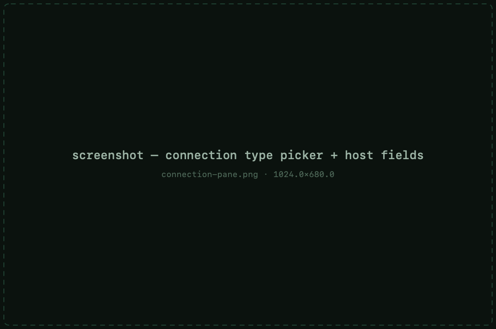
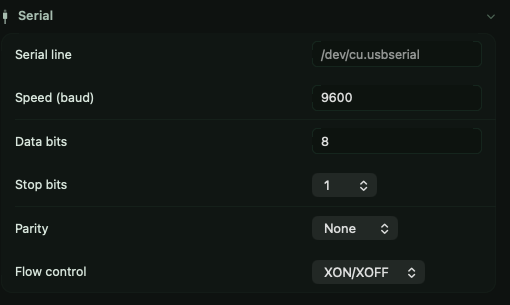
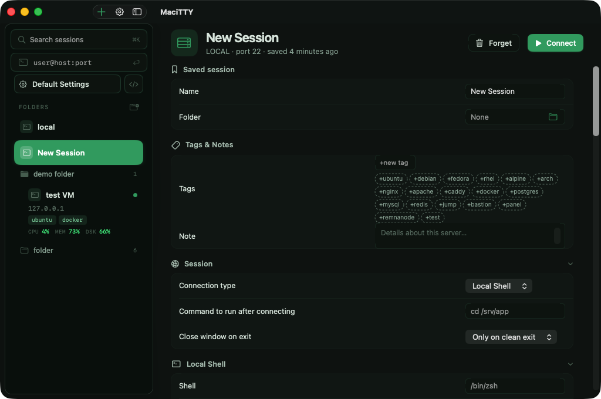
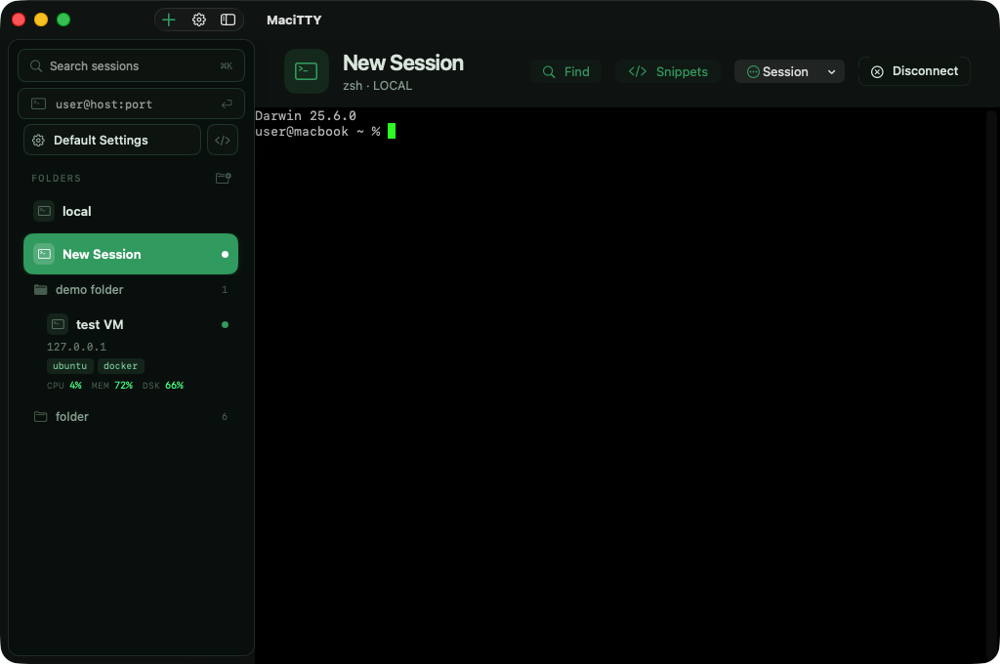

# Connection types

Each session's **Session** pane chooses the protocol and the target.
Connection types are set per session — pick one when creating it.

## SSH

The default and the one you'll use almost everywhere. Fields: host, port,
username — everything else (auth, forwarding, keepalives, host-key policy)
lives on the other setting panes; see [Authentication](authentication.md)
and [Proxies &amp; tunnels](proxies-tunnels.md).

The **SSH** pane carries the less-common protocol options:

- **Remote command** — run a command on the server instead of a shell;
  pair with **Don't allocate a pseudo-terminal** for non-interactive use
- **Don't start a shell or command at all** — for connections that exist
  only to carry port forwardings
- **Enable compression** — helps on slow links
- **Connection sharing** — a second session to the same host reuses the
  open SSH connection instead of re-authenticating
- **SSH protocol version** — SSH-2 only by default; SSH-1 remains for
  legacy gear (don't treat it as secure)

Environment variables to pass to the server live on the **Data** pane.

## Telnet &amp; Rlogin

Plain-text protocols for legacy systems and network gear that still speaks
them. Same session model — saved, reconnectable, loggable. Authentication
options are limited to what the protocol supports.

## Raw TCP

A bare socket to `host:port` — for talking to devices and services that have
no login protocol at all: serial-over-TCP bridges, debug consoles, MUDs,
proprietary appliances. For MUDs and other line-at-a-time services, turn on
**local echo** and **local line editing** on the Terminal pane — there's no
server to echo your input back.

## Serial

Direct serial-port connections for consoles on switches, routers, embedded
boards and anything with a UART.

Settings on the **Serial** pane:

| Setting | Notes |
|---|---|
| Serial line | Pick the port from the list — typically `/dev/cu.usbserial*` or `/dev/cu.usbmodem*` for USB adapters |
| Speed (baud) | `9600` by default; common values `9600`–`115200` |
| Data bits | Usually `8` |
| Stop bits | `1`, `1.5` or `2` — usually `1` |
| Parity | None / odd / even / mark / space — match the device |
| Flow control | None / XON-XOFF (default) / RTS-CTS / DSR-DTR |

> **Tip** — plug in the adapter, then run `ls /dev/cu.*` in a shell to find
> the exact device name before creating the session.

## Local Shell

A real local terminal — your shell on your Mac — as a first-class session:
same sidebar, same settings model, no host required.

- **Shell** — defaults to your `$SHELL` (falling back to `/bin/zsh`, run as
  a login shell)
- **Start directory** — defaults to your home folder
- **Command to run after connecting** (Session pane) — typed into the shell
  once it's up, e.g. `cd ~/project`

Local sessions don't [auto-reconnect](sessions.md#automatic-reconnect) — a
dead shell shouldn't loop-respawn; the "Shell exited" banner restarts it on
demand. The Files tab and [monitoring](monitoring.md) don't apply either —
those need SSH. In the sidebar, a local session shows a terminal icon and
the shell name instead of a host.

> Local Shell exists only in the **direct-download build** — spawning a
> local shell is one of the things the App Store sandbox forbids.

