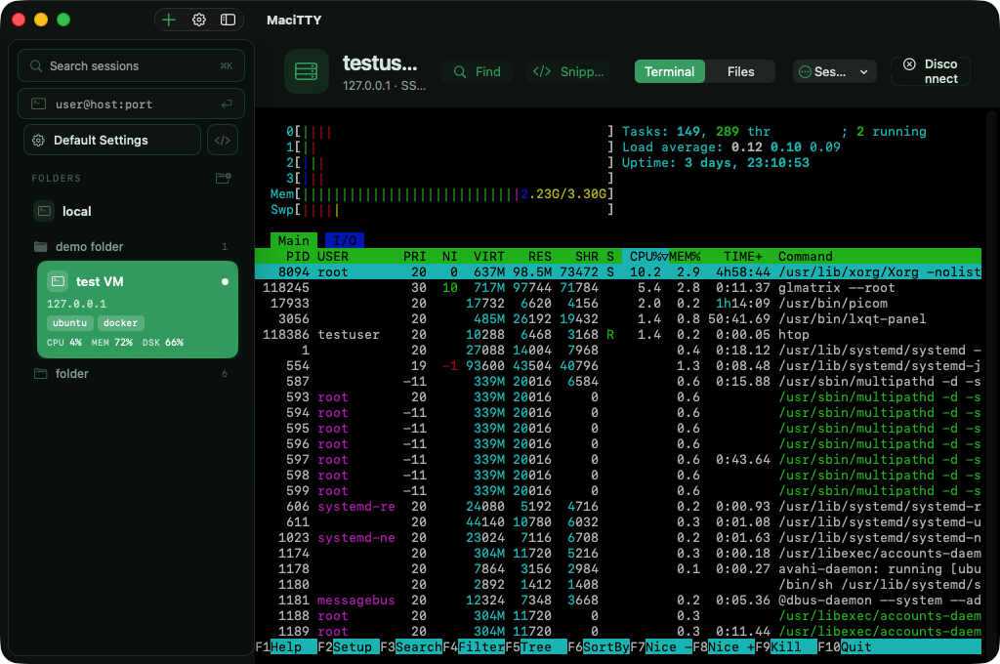
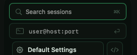
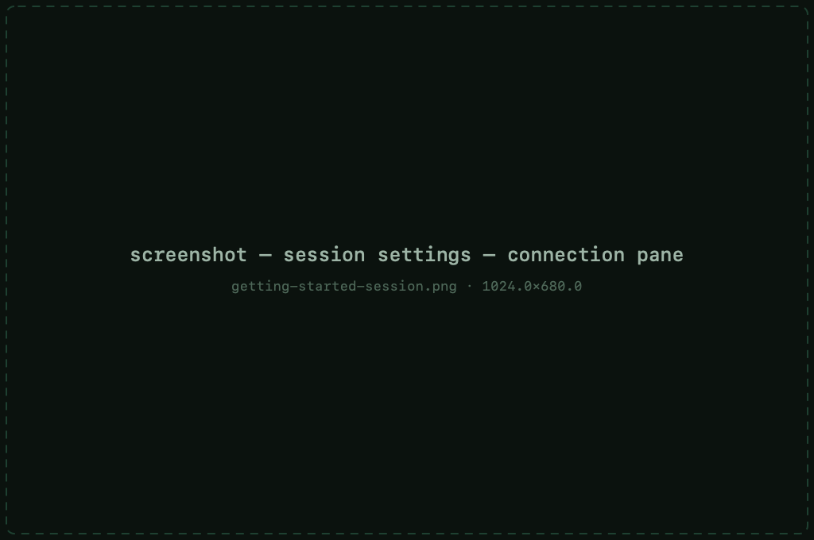

# Getting started

MaciTTY is a native macOS terminal client for SSH, Telnet, Rlogin, raw TCP and
serial connections. It keeps saved sessions in folders, stores credentials in
the Keychain, connects in one click, and includes a built-in dual-pane SFTP
browser — no accounts, no separate apps.



## Requirements

- macOS 14 (Sonoma) or later
- Apple Silicon or Intel — the download is a universal build
- The app is signed and notarized, so it opens without Gatekeeper warnings

## Install

**Disk image (recommended):** download `MaciTTY-latest.dmg` from the
[download page](../index.html#download), open it and drag MaciTTY to
Applications.

**Homebrew:**

```sh
brew install --cask knstntnkek/macitty/macitty
```

**Mac App Store:** the sandboxed build — the direct download keeps a few
power features the sandbox forbids (local shell, agent forwarding, X11).
A Pro purchase covers one channel; see
[Pro &amp; licensing](pro.md#two-versions-two-purchase-channels) for the details.

## Free and Pro

The free tier covers everyday use — 12 saved sessions and 4 connections
at once, no time limit, no account. [MaciTTY Pro](pro.md) lifts the caps
and adds split view, iCloud sync, session logging and snippet export.
Already using MaciTTY before Pro existed? Your install keeps it —
nothing you have is taken away.

## Your first connection

The fastest way in is the **quick connect** field at the top of the sidebar —
type a host (`user@server.example.com` or just a hostname), press Return, and
you're connected. Quick-connect sessions aren't saved; they're for one-off
hops.



For servers you use more than once, save a session instead:

1. Press `⌘N` (or **File → New Session**).
2. Fill in the host, port and username on the **Connection** pane.
3. Pick your authentication on the **SSH** pane — see
   [Authentication](authentication.md).
4. Give the session a name and, optionally, a folder and tags.
5. Press `⌘↩` or click **Connect**.

Saved sessions appear in the sidebar. Double-click one (or select it and
press `⌘↩`) to connect — credentials stored in the Keychain are applied
automatically, so repeat logins don't ask for a password again.



## The main window

Everything lives in one window:

- **Sidebar** — your session library, grouped in folders, with live
  connections, search, tags and (optionally) per-server metrics.
- **Terminal** — live sessions open embedded in the main window; switch
  between them instantly from the sidebar.
- **Files** — an SFTP browser on the same connection, side by side with
  your local files. See [File transfer](sftp.md).

## Updates

MaciTTY checks for updates on a schedule — **weekly** by default. Change the
frequency (daily / weekly / monthly / never) or trigger a manual check from
**MaciTTY → Settings → General → Check Now**. Installing an update shows its
progress and restarts the app for you.
