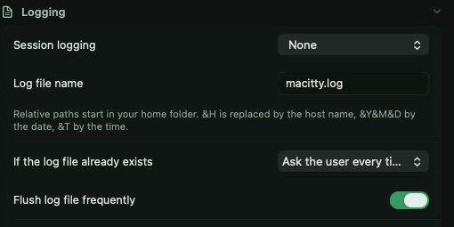
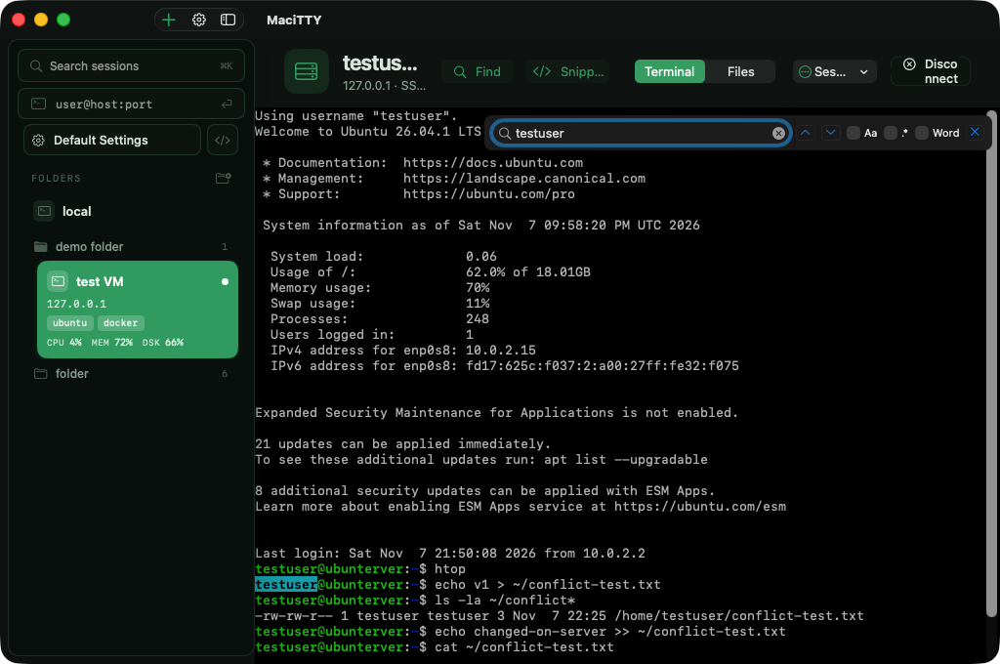

# Session logging

A **MaciTTY Pro** feature — see [Pro &amp; licensing](pro.md).

The **Logging** pane turns on session recording — for change windows,
compliance trails, or just remembering what a command did.

## What gets logged

| Mode | Records |
|---|---|
| Printable output | What you'd read — text as it appeared on screen |
| All session output | Everything the remote sent, including control sequences |
| SSH packets | Protocol-level packet trace — for debugging SSH itself |
| Raw | The raw byte stream |

## File naming

The log filename supports **timestamp placeholders** so every session lands
in its own file — e.g. `server-2026-11-06-1530.log` — or a shared one.

## Existing files

When a log filename already exists, choose what happens:

- **Append** — keep one continuous log per name
- **Overwrite** — fresh file every session
- **Ask** — decide at connect time

> **Tip** — logging is per session (or via
> [Default Settings](sessions.md#default-settings), for everything). The
> files are plain text — point them at a folder you archive, not the
> Desktop.

## Finding text in a session

A find bar searches the visible scrollback:

- `⌘F` — open find, `⌘⇧F` — close it
- `⌘G` / `⌘⇧G` — next / previous match
- `⌘E` — use the current selection as the search text

Case, regex and whole-word toggles live in the bar itself.

