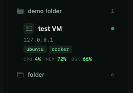
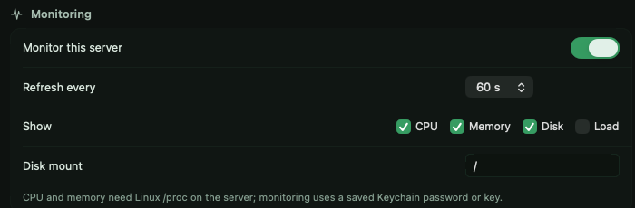

# Server monitoring

Opt in per server and its live vitals render right in its sidebar row —
**CPU, memory, disk and load** — without opening a terminal or a separate
dashboard.

## Enabling it

Monitoring is off by default. Turn it on in a session's settings — it's a
per-server opt-in, so you watch the boxes that matter and nothing polls the
rest.

## What you see

- **CPU** — current utilisation
- **Memory** — usage of system RAM
- **Disk** — root filesystem usage
- **Load** — system load average

Values recolor by severity — green when calm, then **amber** and **red** as
load climbs — and a health dot flags a server crossing the warn line.

## Poll interval

Pick how often metrics refresh, from **15 seconds** up to **5 minutes** —
snappier polling for a server you're actively watching, slower for a fleet.
The poll runs over the existing SSH connection; there's no agent to install.
