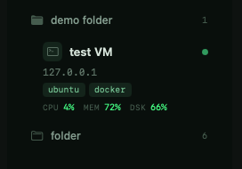
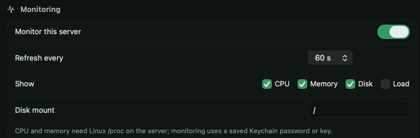

# Server monitoring

Opt in per server and its live vitals render right in its sidebar row —
**CPU, memory, disk and load** — without opening a terminal or a separate
dashboard.

## Enabling it

Monitoring is off by default. Turn it on in the **Monitoring** card of a
session's settings, or right-click the session → **Enable monitor** — it's a
per-server opt-in, so you watch the boxes that matter and nothing polls the
rest. Monitoring logs in on its own, so the session needs a password saved
in the Keychain or a key.

## What you see

Tick which metrics to show — CPU, memory and disk are on by default, load
is off:

- **CPU** — current utilisation
- **Memory** — usage of system RAM
- **Disk** — usage of the **Disk mount** you set (`/` by default)
- **Load** — system load average

CPU and memory need Linux `/proc` on the server.

Values recolor by severity — green when calm, then **amber** and **red** as
load climbs — and a health dot flags a server crossing the warn line.

## Poll interval

**Refresh every** picks how often metrics refresh — 15 s, 30 s, 60 s (the
default), 2 m or 5 m — snappier polling for a server you're actively
watching, slower for a fleet. The poll runs over its own background SSH
connection — no terminal needs to be open, and there's no agent to install.
