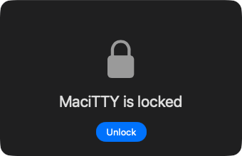

# Privacy &amp; security

MaciTTY's model is simple: **your data lives on your Mac** — there's no
vendor cloud, no account, no telemetry, nothing to breach.

## Where things are stored

- **Sessions, folders, tags, notes, snippets, settings** — in the app's
  local storage under your user account
- **Passwords and credentials** — in the macOS **login Keychain**, managed
  by the system, encrypted at rest — never in session files
- **Known host keys** — stored locally, like `~/.ssh/known_hosts`

## App lock

Lock the whole app behind **Touch ID or your login password** — `⌃⌘L`
(**MaciTTY → Lock MaciTTY**) or automatically after idle. While locked,
windows are hidden and the app shields itself from screen capture. Enable
it in Settings; it's optional.

## iCloud sync

Optional sync carries your library to your other Macs — sessions, folders,
tags, notes, snippets and settings — through **your own private iCloud
account** (CloudKit). Apple holds the data under your account; MaciTTY has
no servers of its own.

**Credentials are deliberately never synced** — passwords stay in each
Mac's own Keychain, so a synced session on a second Mac still asks you to
save its password once, locally.

Sync is off unless you turn it on.

## What isn't collected

No analytics, no crash-reporting service, no ads, no account. The only
network calls the app makes are to the servers *you* connect to — and to
the update feed when update checks run (which you can set to
[never](getting-started.md#updates)).
