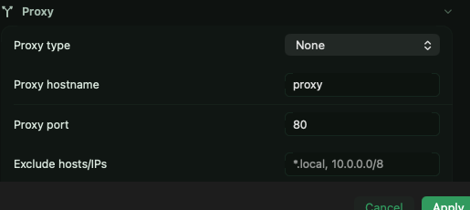
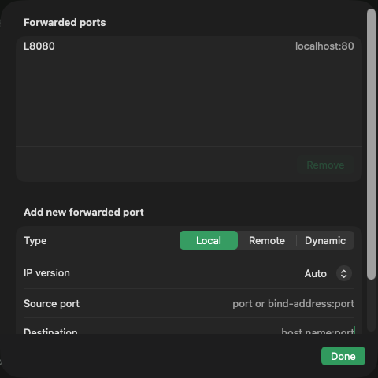

# Proxies &amp; tunnels

The **Proxy** and **Tunnels** panes cover everything between your Mac and
the target: bastions, corporate proxies, and SSH port forwarding.

## Proxy types

The Proxy pane's **Proxy type** setting:

| Type | Use |
|---|---|
| SOCKS 4 / SOCKS 5 | Classic SOCKS proxies |
| HTTP CONNECT | Corporate web proxies that allow CONNECT |
| Telnet | Proxies spoken to with a Telnet command |
| Local command | Any local program as transport — e.g. `nc`, `corkscrew` |
| SSH to proxy + port forwarding | SSH jump host (like `ProxyJump`) |
| SSH to proxy + command | Jump host running a command |
| SSH to proxy + subsystem | Jump host running a subsystem |

The pane also has proxy host/port, an **exclude list** for hosts that should
bypass the proxy, DNS-at-proxy-end control, and the command/credentials
fields the chosen type needs.

## Jump hosts

For the common "connect through a bastion" case, pick an SSH-to-proxy type
and fill in the jump host's address and credentials — equivalent to OpenSSH's
`ProxyJump`. Sessions [imported from `~/.ssh/config`](sessions.md#importing-sshconfig)
with `ProxyJump` land here automatically.

## Port forwarding

The **Tunnels** pane's forwarding table adds rows of:

- **Local** — listen locally, forward to a host the *server* can reach
- **Remote** — listen on the server, forward back to your side
- **Dynamic** — a local SOCKS proxy tunnelled over the connection

Each row takes a source port and a destination `host:port`; forwards start
with the connection and live as long as it does.

## Also on this pane

- **Agent forwarding** — expose your local `ssh-agent` to the remote
- **X11 forwarding**
- **GSSAPI credential forwarding** — delegate your Kerberos ticket

TCP keepalives are on the Connection pane — useful for connections that idle
through NATs or firewalls.
