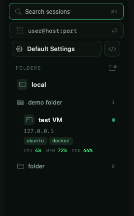
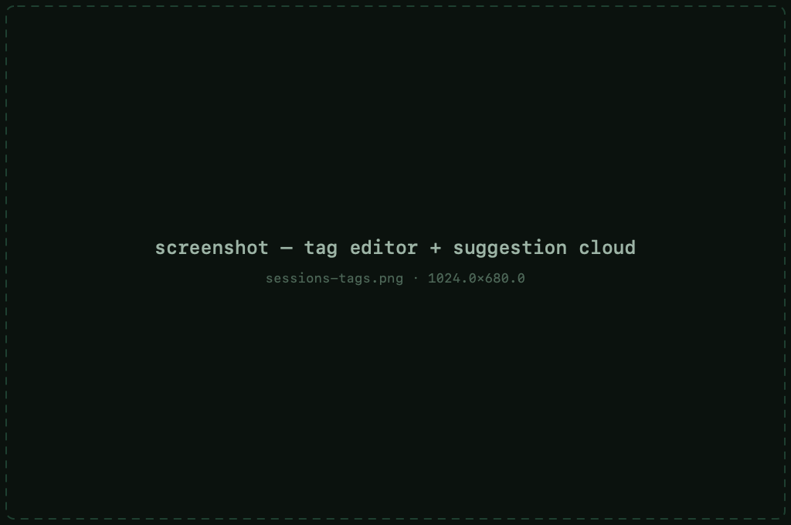
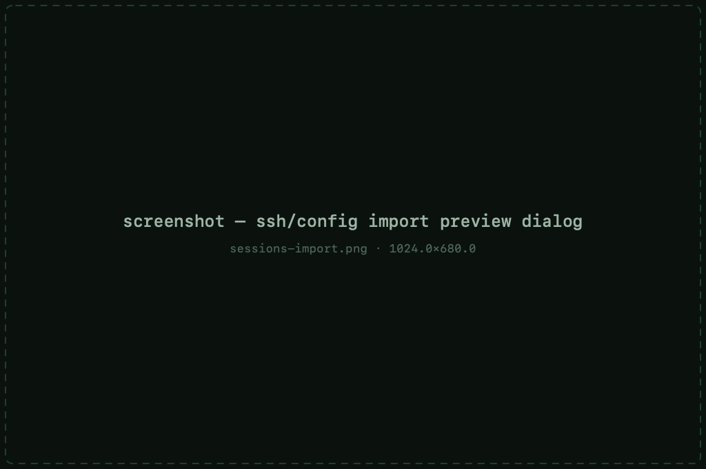

# Sessions &amp; the library

The sidebar is your session library: every server you save lives here,
grouped in folders, searchable, and one click away from a connection.

## Saving sessions

- `⌘N`, **File → New Session** or the sidebar's **+** button creates a session
  in the current folder and opens its settings.
- Sessions are edited in place — select one in the sidebar to see every
  setting it carries.
- Right-click a saved session → **Duplicate** to copy it — handy for a second
  host that differs only in address. (`⌘D` is different: it opens a second
  *connection* to the focused live session.)
- `⌘⇧L` (**File → Saved Sessions**) focuses the library from anywhere.

The free tier keeps **12 usable sessions** — anything beyond that stays
saved, locked, never deleted. [Pro](pro.md) opens every session in the
library.

## Folders

Group sessions in folders however you think — by client, by environment, by
project. Drag a session onto a folder (or onto any session inside it) to move
it there; drop it on a top-level row to take it out of its folder. Folders
are listed alphabetically and collapse with a click.

## Default Settings

Every session inherits from the **Default Settings** profile at the top of
the library. Change a setting there — font size, keepalives, terminal type —
and it applies to every session that doesn't override it explicitly. This is
the fastest way to change something "everywhere".

## Search

`⌘K` focuses the search field. It matches session names, folder names,
hostnames and **tags** — typing a tag finds every session carrying it.

## Tags &amp; notes

Tags label what a session *does* — `prod`, `db`, `router`, `work`. Tags are
edited on the session's **Tags &amp; Notes** card; up to three chips appear under
each host in the sidebar (with a `+N` for the rest), and a suggestion cloud offers existing
tags as you type so they stay consistent.

Each session also has a private **note** — free text for anything worth
remembering: who owns the box, why that weird port, the maintenance window.

Both tags and notes [sync with your other Macs](privacy.md#icloud-sync).

## Live connections

Connected sessions show live in the sidebar. Clicking one switches to its
terminal instantly; the sidebar row also carries a status indicator, a
close control and — when [monitoring](monitoring.md) is enabled — live
CPU/memory/disk/load metrics.

Right-clicking a live connection offers **Open in New Pane** and
**Disconnect**. The **Session** menu in the pane toolbar carries the rest:

- **Duplicate Session** (`⌘D`) — a second connection with the same settings
- **Event Log** — the connection's diagnostic output
- **Special Command** — send protocol specials (break, signals, …)
- **Restart Session** — reconnect the session
- **Change Settings** — adjust this connection mid-flight without touching
  the saved profile; **Saved Settings** opens the saved session instead

Run two panes side by side with [split view](terminal.md#split-view) — a
Pro feature — and jump between them with `⌘]`/`⌘[`; opening a fifth
connection hits the free tier's
[concurrent limit](pro.md#what-pro-unlocks).

## Importing `~/.ssh/config`

The sidebar's **+** menu → **Import from SSH Config…** reads your OpenSSH
config and turns every concrete `Host` entry into a saved session:

- `Include`d files are followed
- `HostName`, `User`, `Port`, `IdentityFile`, `CertificateFile`,
  `ProxyJump`/`ProxyCommand`, `LocalForward`/`RemoteForward`/`DynamicForward`,
  `SendEnv`/`SetEnv`, `ForwardAgent`, `Compression`, `ServerAliveInterval`,
  `TCPKeepAlive`, `AddressFamily`, `RequestTTY`, `RemoteCommand` and the
  GSSAPI options are carried over
- You get a **preview** first — tick the hosts you want, and directives
  MaciTTY can't map are listed per host; nothing is written until you confirm
- Imported sessions land in an **Imported SSH Config** folder
- The App Store version asks you to choose your `.ssh` folder once, so it can
  read the config, its includes and the key files it references

## Run a command on connect

The Session pane's **Command to run after connecting** sends a command as
soon as the session opens — `cd /srv/app`, `tail -f app.log`, a jump to
your working directory. For longer sequences, [snippets](snippets.md) can
be run on demand from the toolbar instead.

## Automatic reconnect

When a connection *drops* — Wi-Fi blip, laptop sleep, server restart —
MaciTTY retries it automatically with patient, escalating backoff. When it
comes back, your terminal (scrollback included) and the SFTP pane are
restored.

Reconnect only applies to dropped connections: a session you closed, or one
the remote ended cleanly (`exit`, `logout`), stays closed. It's on by
default and can be switched off per session with **Auto-reconnect on
connection loss** on the Session pane.
