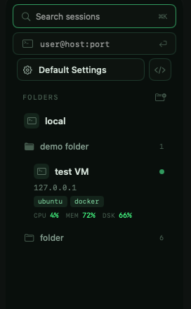
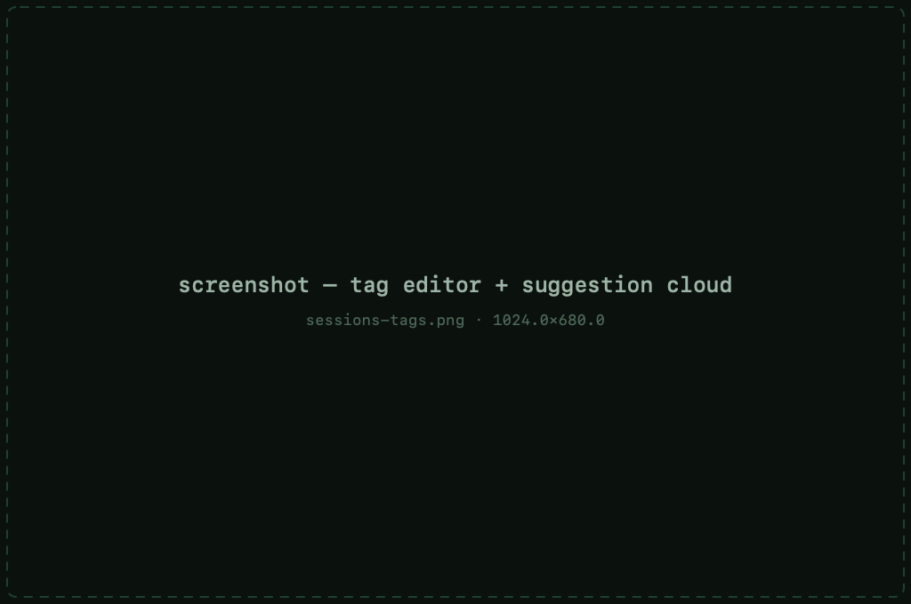
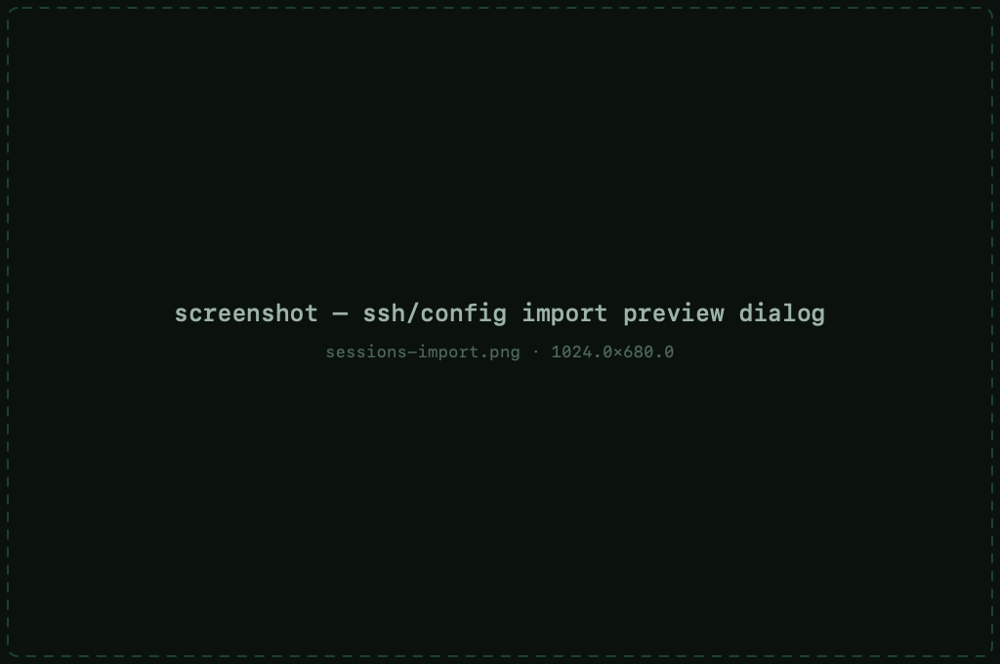

# Sessions &amp; the library

The sidebar is your session library: every server you save lives here,
grouped in folders, searchable, and one click away from a connection.

## Saving sessions

- `⌘N` or **File → New Session** creates a session and opens its settings.
- Sessions are edited in place — select one in the sidebar to see every
  setting it carries.
- `⌘D` duplicates the selected session — handy for a second host that differs
  only in address.
- `⌘⇧L` (**File → Saved Sessions**) focuses the library from anywhere.

The free tier keeps **12 usable sessions** — anything beyond that stays
saved, locked, never deleted. [Pro](pro.md) opens every session in the
library.

## Folders

Drag sessions into folders to group them however you think — by client, by
environment, by project — and drag to reorder within them. Folders can be
collapsed; the library keeps the arrangement between launches.

## Default Settings

Every session inherits from the **Default Settings** profile at the top of
the library. Change a setting there — font size, keepalives, terminal type —
and it applies to every session that doesn't override it explicitly. This is
the fastest way to change something "everywhere".

## Search

`⌘K` focuses the search field. It matches session names, hostnames, users
and **tags** — typing a tag finds every session carrying it.

## Tags &amp; notes

Tags label what a session *does* — `prod`, `db`, `router`, `work`. Chips
appear under each host in the sidebar, and a suggestion cloud offers existing
tags as you type so they stay consistent.

Each session also has a private **note** — free text for anything worth
remembering: who owns the box, why that weird port, the maintenance window.

Both tags and notes [sync with your other Macs](privacy.md#icloud-sync).

## Live connections

Connected sessions show live in the sidebar. Clicking one switches to its
terminal instantly; the sidebar row also carries a status indicator, a
close control and — when [monitoring](monitoring.md) is enabled — live
CPU/memory/disk/load metrics.

Right-clicking a live connection opens its context menu: **Duplicate
Session** opens a second connection with the same settings, **Event Log**
shows the connection's diagnostic output, and **Change Settings** adjusts
this session mid-flight without touching the saved profile.

Run two panes side by side with [split view](terminal.md#split-view) — a
Pro feature — and jump between them with `⌘]`/`⌘[`; opening a fifth
connection hits the free tier's
[concurrent limit](pro.md#what-pro-unlocks).

## Importing `~/.ssh/config`

**File → Import SSH Config** (also offered when you first run MaciTTY) reads
your OpenSSH config and turns every `Host` into a saved session:

- `Include`d files are followed
- `HostName`, `User`, `Port`, `IdentityFile`, `ProxyJump` and port
  forwardings are carried over
- You get a **preview** of everything it found before a single session is
  created — nothing is written until you confirm

## Automatic reconnect

When a connection *drops* — Wi-Fi blip, laptop sleep, server restart —
MaciTTY retries it automatically with patient, escalating backoff. When it
comes back, your terminal (scrollback included) and the SFTP pane are
restored.

Reconnect only applies to dropped connections: a session you closed, or one
the remote ended cleanly (`exit`, `logout`), stays closed. It's on by
default and can be switched off per session.
