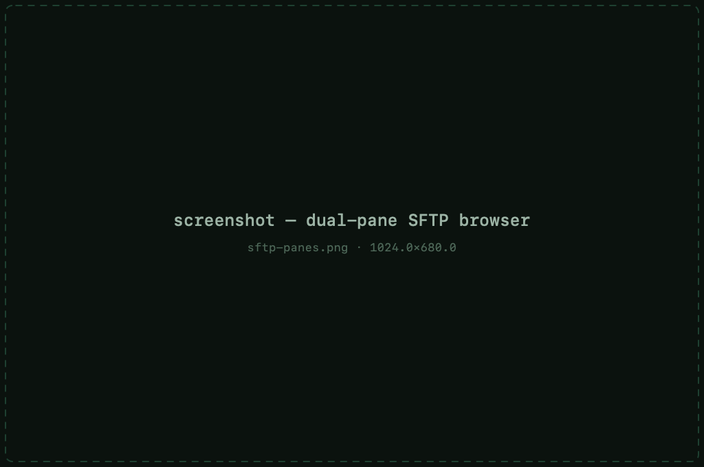
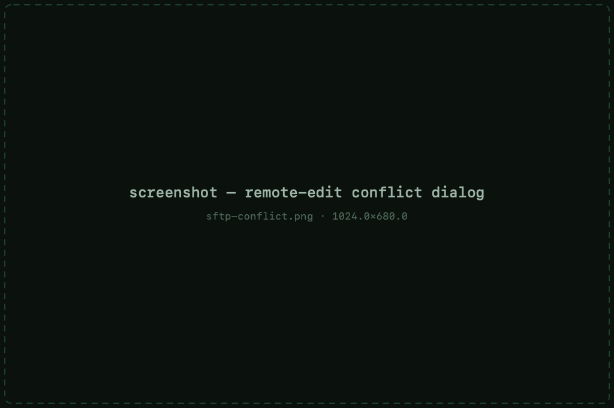
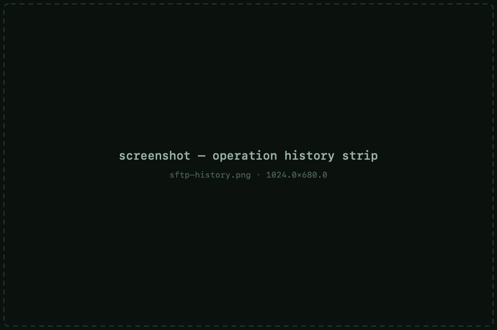

# File transfer (SFTP)

Every SSH session has a **Files** tab: a dual-pane SFTP browser in the same
window — no second app. Files opens its own SFTP connection to the server
with the session's settings and saved credentials, so a saved password or
key signs it in without asking; if nothing is saved, you're prompted again.
Closing the session also closes its Files tab.

## Getting around

- Local files on one side, remote on the other — swap focus freely
- **Editable path fields** on both panes — type or paste a path to jump
- `..` rows at the top of each listing to walk up
- **Hidden files** toggle per pane
- **Symlink badges** mark links so you know what you're copying
- Right-click menus carry the file actions: rename, delete, new folder,
  permissions, open

## Transferring

- **Drag &amp; drop** — between panes, from Finder into the remote pane,
  and remote rows straight out to Finder, Desktop or Mail — the download
  runs through the normal transfer machinery with progress
- Recursive transfers — whole directory trees copy with progress
- Overwriting existing files asks **Replace / Skip Existing / Cancel**

## Editing remote files

Open a remote file and it downloads to a temp copy in your favourite local
editor. Every save uploads it back automatically. If the file changed on the
server in the meantime, MaciTTY detects the **conflict** instead of silently
clobbering the remote version.

## Operation history

A collapsible **history** strip at the bottom of the Files tab lists every
operation — copy, move, delete, rename, edit — with its result and time, so
you can always see what ran and what failed.

> **Note** — the Files tab shares the session's connection. When a dropped
> connection [reconnects](sessions.md#automatic-reconnect), the SFTP pane
> comes back with it.
