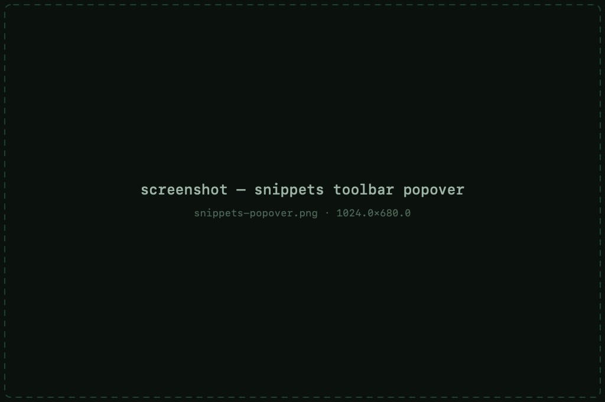
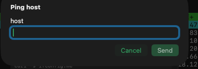

# Snippets

Snippets are saved command texts — the things you type over and over — kept
one click away in the toolbar popover and manageable in the sidebar.

## Using a snippet

Click the snippets button in the toolbar to open the popover:

- **Click a row** — inserts the text at the prompt *without* Enter, so you
  can review or complete it first
- **Run** — sends the text *and* presses Enter

If the snippet contains prompt variables, a small sheet collects their
values first.

## Variables

Snippets are templates. Two kinds of placeholders:

**Built-ins** — filled from the session and the clock, automatically:

`{host}` `{user}` `{port}` `{session}` `{date}` `{time}` `{timestamp}`

**Prompt variables** — asked every time you use the snippet:

- `{{name}}` — required; Run stays disabled until it's filled
- `{{name?}}` — optional; can be left empty

So `ping -c 4 {{target}}` pastes your current host's user into the text but
asks for `target` each time.

## Managing snippets

The sidebar's snippets section lists them all; add, edit, reorder or delete
there. A few **example snippets** ship with the app — they double as a demo
of the variable syntax and can be deleted like any other.

## Sharing &amp; sync

Snippets **export/import as JSON** — a
[Pro](pro.md) feature, and a quick way to move a library between
Macs or share it with a teammate.

They also [sync via iCloud](privacy.md#icloud-sync) with the rest of your
data — another Pro feature — so a snippet saved on one Mac shows up on the
others.
