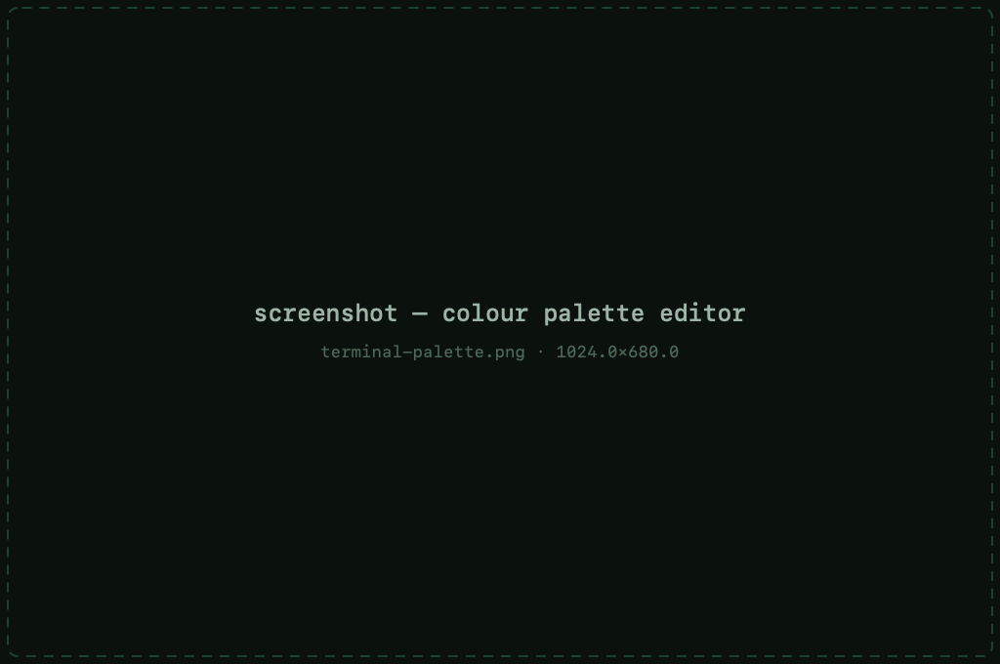
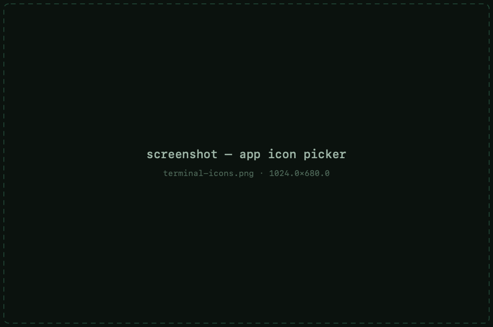

# Customizing the terminal

The **Terminal** panes of session settings — and of
[Default Settings](sessions.md#default-settings) — control how sessions
look and behave.

## Themes &amp; appearance

- **App theme** — light, dark or follow the system, remapped around the
  app's green palette
- **Colours &amp; palette editor** — ANSI palette and terminal colors,
  editable per session or for everything via Default Settings
- **Font, size and window** — font, font size (13 pt default), columns ×
  rows (80 × 24) on the Window pane
- **Cursor** — block / underline / vertical line, blinking or steady

## Split view

A **MaciTTY Pro** feature: run two panes side by side in the same window —
two terminals, or a terminal and its files.

- Toggle with the **Split** button in the pane toolbar, or right-click a
  session in the sidebar → **Open in New Pane**
- `⌘]` and `⌘[` move keyboard focus between panes
- Each pane is a viewport onto a live connection — close one and the
  session keeps running in the other; drag the divider to rebalance

## Bell &amp; alerts

The **Bell** pane controls what a terminal bell does: nothing, the system
alert sound, or a visual flash of the window — plus a **Dock** indication
that flashes the icon briefly or bounces it until you switch to MaciTTY. A
bell that fires too often is temporarily silenced.

## Behaviour

- **Scrollback** — how much history to keep (2000 lines by default), and
  whether cleared screens go into scrollback
- **Local echo &amp; local line editing** — off by auto-detection; force
  them on for [Raw TCP](connection-types.md#raw-tcp) sessions and other
  services that don't echo input themselves

## Keyboard &amp; charset

- **Keyboard modes** — Backspace, Home/End, function-key and keypad modes
  for applications that distinguish them
- **Option as Meta** — make the Option key send an ESC prefix
- **Character sets** — **26 charsets**: UTF-8 plus the legacy encodings
  for gear and systems that predate Unicode

## App icon

Four app icons to pick from in **Settings → Appearance** — Matrix, Monitor,
Outline and Peek.

