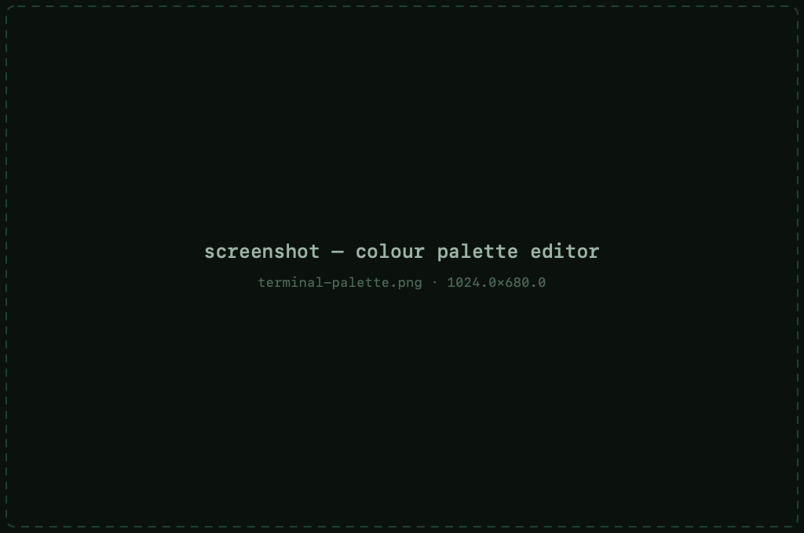
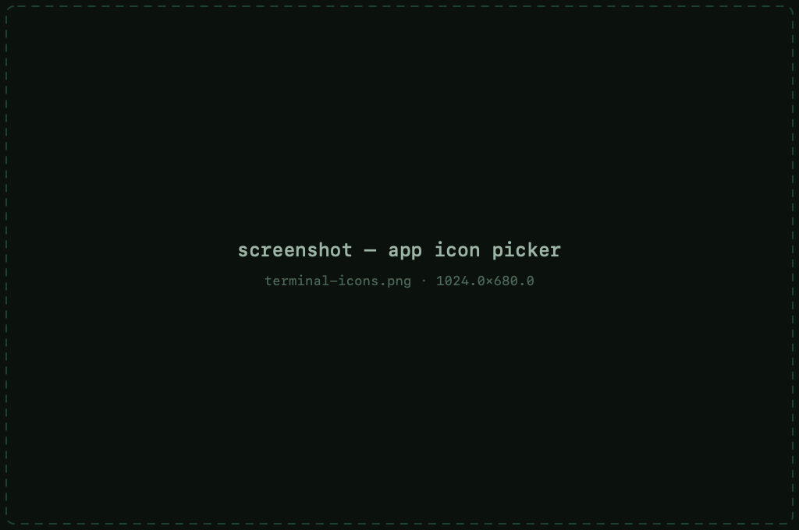

# Customizing the terminal

The **Terminal** panes of session settings — and of
[Default Settings](sessions.md#default-settings) — control how sessions
look and behave.

## Themes &amp; appearance

- **App theme** — light, dark or follow the system, remapped around the
  app's green palette
- **Colours &amp; palette editor** — ANSI palette and terminal colors,
  editable per session or for everything via Default Settings
- **Cursor** — block / underline / bar, blinking or steady

## Bell &amp; alerts

Control what a terminal bell does: audible bell, visual flash, and **Dock
alerts** — bounce the icon when a background session beeps or finishes.

## Keyboard &amp; charset

- **Keyboard modes** — function-key and keypad modes for applications that
  distinguish them
- **Character sets** — UTF-8 plus **25 legacy charsets** for gear and
  systems that predate Unicode

## App icon

Four alternate app icons to pick from in Settings — including variants for
light and dark docks.

## Finding text in a session

A find bar searches the visible scrollback:

- `⌘F` — open find, `⌘⇧F` — close it
- `⌘G` / `⌘⇧G` — next / previous match
- `⌘E` — use the current selection as the search text

Case, regex and whole-word toggles live in the bar itself.
